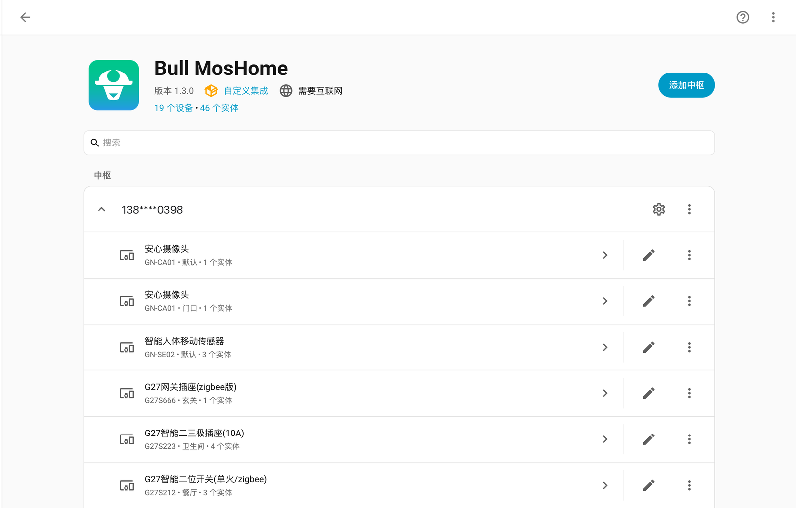

<p align="center">
  
</p>

<h1 align="center">Bull MosHome</h1>

<p align="center">
  把公牛智家（MosHome）设备接入 Home Assistant 的自定义集成<br>
  <sub>同时提供独立 Python 客户端与完整的协议分析文档</sub>
</p>

<p align="center">
  <a href="https://github.com/gn0451/bull-moshome/actions/workflows/validate.yml"></a>
  
  
</p>

---

## 这是什么

一个 Home Assistant 自定义集成：登录公牛智家账号，把账号下的开关、灯、窗帘、传感器和
充电桩变成 HA 实体，支持云端正向控制与 MQTT 状态回推。

> 本项目是非官方社区项目，与公牛集团及 MosHome 官方无隶属或背书关系。
> MosHome 名称与标识归其权利人所有。

<p align="center">
  
</p>

<!-- 实体列表截图待补：docs/images/ha-entities.png（某台多路开关的实体列表，体现通道命名） -->

## 为什么选这个

- **能力分级，不靠猜。** 每台设备按 `device_profiles.json` 的档案分级：已验证、有档案、
  安全推断、只读、专用。未收录的负载设备会建实体但**默认禁用**，由你确认后再启用；
  电池供电的情景面板和摄像头不会因为属性里有个 `PowerSwitch` 就被当成开关。
- **证据可追溯。** 每个 PID 都标了 `evidence_level` / `verified_on` / `app_version`，
  区分「协议事实」「社区参考」「本项目实测」。详见 [PROVENANCE.md](PROVENANCE.md)。
- **实时靠推送，轮询只是兜底。** MQTT 长连接接收云端回推，物理按键操作后秒级同步；
  默认 300 秒轮询做对账，可在选项里改 15–3600 秒。
- **诊断不泄露隐私。** 一键导出的诊断只含协议标识符与支持等级，不含账号、家庭 ID、
  设备 ID、昵称、房间和属性值。

## 支持范围

| 类别 | 已收录 PID | 实体 |
|---|---|---|
| 开关 / 插座 / 转换器 | 25 | 每路通道一个 `switch`，名称取 App 内昵称 |
| 灯具 | 7 | `light`，亮度 + 色温（3000–5700K） |
| 窗帘电机 | 6 | `cover`，支持开合与停止 |
| 充电桩 | 10 | `switch` + 功率/电量 `sensor` + PID 258 激活充电 `button` |
| 充电桩（BLE 直连） | 1（PID 309） | 本地蓝牙控制，兼容 ESPHome Bluetooth Proxy |
| 数显桌面充电站 | 1（PID 296） | 总电源、六路 USB、熄屏、功率模式、亮度、逐口遥测 |
| 只读设备 | 4 | 网关插座、电池情景面板、摄像头：只给状态与诊断，不生成负载控制 |

完整 PID 清单见 [`device_profiles.json`](custom_components/bull/device_profiles.json)，
新增设备的贡献流程见 [COMPATIBILITY.md](COMPATIBILITY.md)。

## 与 hass-iotbull 的关系

本项目的设备覆盖范围（PID 清单）、`bull` 域名与实体唯一 ID 规则沿用自
[stevenjoezhang/hass-iotbull](https://github.com/stevenjoezhang/hass-iotbull)，
以便现有用户原位迁移。两者的**实现相互独立**，本项目与其无隶属关系，也不代表其立场。

| | 本项目 | hass-iotbull |
|---|---|---|
| 分发 | HACS / 手动 | HACS |
| 设备识别 | 档案分级 + 未知设备默认禁用 | PID 白名单，未收录直接跳过 |
| 设备清单 | `device_profiles.json`（可审、带证据等级） | 代码内常量集合 |
| 家庭范围 | 安装时选择，选项里可改 | 安装时多选 |
| 隐私 | 匿名诊断导出 | 上报 `globalProductId` / `productName` / `property` 用于适配分析 |
| 凭证失效 | 自动重登 + reauth，且校验账号未变 | 自动重登 + reauth |
| 许可 | MIT | 未声明 LICENSE |

如果你只是想要一个能用的集成，两者都能用；本项目的差异主要在**未知设备的处理方式**
和**证据透明度**。

## 安装（Home Assistant）

要求 Home Assistant **2024.6 或更新**。

### HACS（推荐）

1. HACS → 集成 → 右上角菜单 → **自定义存储库**。
2. 添加 `https://github.com/gn0451/bull-moshome`，类型选 **集成**。
3. 搜索 **Bull MosHome** 下载，重启 Home Assistant。
4. 设置 → 设备与服务 → 添加集成 → 搜索 **Bull MosHome** → 输入公牛智家账号密码。

> 账号若一直用手机验证码登录，需先在 App 内（我的 → 设置 → 账号与安全）设置一个密码，
> 本集成只支持账号密码登录。

### 手动安装

```bash
cp -R custom_components/bull /path/to/ha/config/custom_components/
# 重启 HA
```

详见 [homeassistant/INSTALL_HA.md](homeassistant/INSTALL_HA.md)。

### 从 hass-iotbull 迁移

本集成沿用 `bull` 域名，因此**不能与 hass-iotbull 同时安装**——两者会写入同一个
`custom_components/bull` 目录并争用同一个配置条目。

1. 在 HACS 中移除 `hass-iotbull` 仓库（或手动删除 `custom_components/bull/`）。
2. 确认该目录已不存在，避免旧文件（如 `api.py`）与新实现混装。
3. 按上面的步骤安装 **Bull MosHome**，重启 Home Assistant。
4. 原有配置条目会被复用（旧字段 `selected_families` 自动映射为 `family_ids`），
   实体唯一 ID 保持 `<iotId>.<identifier>` 不变，自动化与外部白名单无需修改。
5. 若提示重新验证，重新输入一次账号密码即可；成功后建议在“选项”里确认家庭范围。

> 迁移前建议备份 `config/custom_components/bull` 与 HA 的 `.storage` 目录。

## 安全与隐私

- **云端 MQTT 是明文连接。** 官方 App 使用 `emqx-prod.iotbull.com:1883`（无 TLS），
  本集成沿用同一通道，`openid` 与 `access_token` 会以明文经过公网。这是协议现状，
  无法在客户端侧修复。若你的网络环境不可信，可在集成选项中**关闭 MQTT 推送**，
  仅使用轮询——代价是状态更新延迟到一个轮询周期。
- **密码保存在 HA 的 `.storage`**（配置条目内），与其它集成的凭据同等对待；
  删除集成条目即清除。
- **大功率设备请谨慎自动化。** 通过云端接口控制充电桩、加热器存在风险，
  不要设置无人值守的长时间通电策略。

## Python 客户端与 CLI

集成内附的客户端可以单独使用，仅依赖 `requests`、`cryptography`、`paho-mqtt`。

```bash
pip install requests cryptography paho-mqtt
```

```python
from bull_iot import BullCloudClient

with BullCloudClient() as client:
    client.login("你的账号", "你的密码")
    devices = client.list_devices()
    for d in devices:
        print(d.iot_id, d.name, d.properties)
    client.set_property(devices[0].iot_id, "PowerSwitch", 1)
```

```bash
# 不登录，验证签名实现是否被云端网关接受（假凭证探活）
python -m bull_iot.cli probe

python -m bull_iot.cli devices
python -m bull_iot.cli set --iot-id <iotId> --identifier PowerSwitch --value 1
python -m bull_iot.cli watch --seconds 60              # MQTT 实时监听
python -m bull_iot.cli watch --wildcard --seconds 30   # 话题发现
```

凭证优先级：`--user/--password` > 环境变量 `BULL_USERNAME`/`BULL_PASSWORD` > 交互输入。

## 文档

| 文件 | 内容 |
|---|---|
| [PROTOCOL.md](PROTOCOL.md) | 协议分析：签名算法、加密方式、全部端点、实测校准过程 |
| [PROVENANCE.md](PROVENANCE.md) | 证据边界：协议事实 / 兼容性参考 / 本项目实测 |
| [COMPATIBILITY.md](COMPATIBILITY.md) | 支持等级定义、未知设备贡献流程 |
| [GUIDE.md](GUIDE.md) | 完整使用指南：安装、自动化示例、FAQ |
| [CHANGELOG.md](CHANGELOG.md) | 版本变化 |

## 项目结构

```
bull_iot/                 独立 Python 客户端（CLI 与库）
  crypto.py               登录字段加密（AES-CBC / 双 SHA256）
  signing.py              CloudAPI x-ca-* HMAC-SHA256 签名
  client.py               HTTP 客户端：登录、家庭、设备、控制
  mqtt_listener.py        MQTT 实时状态监听
custom_components/bull/   Home Assistant 集成（HACS 分发单元）
  coordinator.py          轮询 / 登录恢复 / MQTT 调度 / BLE 归属
  device_profiles.json    设备档案与证据等级（单一事实来源）
  switch.py light.py cover.py sensor.py binary_sensor.py
  select.py number.py button.py diagnostics.py
  client.py 等 4 个文件    上述客户端的副本（HACS 只能分发本目录）
tests/                    离线单元测试
homeassistant/tests/      集成端到端 mock 测试（15 个场景）
scripts/check_consistency.py  副本同步与版本号一致性自检
```

`bull_iot/` 与 `custom_components/bull/` 的四个共享模块必须逐字节一致，由 CI 强制校验：

```bash
python scripts/check_consistency.py
python -m pytest -q tests/test_client_unit.py
python homeassistant/tests/test_e2e.py     # 需安装 homeassistant
```

## 实测状态（2026-10-25）

- 登录 / 家庭 / 设备 / 控制四类端点的**签名与加密均已对线上网关验证通过**
  （假凭证返回业务错误码而非签名错误，见 PROTOCOL.md 第 11.1 节）
- **真实账号全链路已实测**：登录成功、448 台唯一设备完整拉取、MQTT 绑定应答 `code=200`、
  **真实设备控制指令已下发并验证**（`setDeviceProperty` 关闭 G27 开关通道，云端接受且回读一致，
  见 PROTOCOL.md 第 11.2 节）
- MQTT 属性回推需设备状态变化时触发；监听窗口内无物理操作时只会看到绑定应答

## 贡献

- 新设备请按 [COMPATIBILITY.md](COMPATIBILITY.md) 的流程提交 PID、属性快照和期望能力，
  并说明证据来源（真机控制回读 > 账号清单观察 > 协议推测）。
- 提交前请本地跑通 `ruff check .`、`scripts/check_consistency.py` 和两个测试脚本。
- 发现实现与外部项目高度相似时，请指出，会补充署名或重写。

## 联系方式

技术交流 / 问题反馈：直接提 [Issue](https://github.com/gn0451/bull-moshome/issues)；
需要加微信请在 Issue 中说明，加好友请注明 **BULL**。

## 致谢与来源

本项目的协议分析、客户端与集成实现由作者独立完成，但在设备覆盖范围、兼容性判断和
若干公开协议行为的验证上，受益于以下公开工作：

- **[stevenjoezhang/hass-iotbull](https://github.com/stevenjoezhang/hass-iotbull)**
  —— 最早把 MosHome 设备接入 Home Assistant 的社区实现。本项目的设备覆盖范围
  （开关 / 灯 / 窗帘 / 充电桩的 PID 清单）、`bull` 域名与实体唯一 ID 规则沿用自该项目，
  以便现有用户原位迁移。
- **[Home Assistant](https://www.home-assistant.io/)** —— 集成框架、Hassfest 校验规范
  与 HACS 分发体系。
- **MosHome（公牛智家）官方 App** —— 协议字段、签名算法与设备能力边界的唯一事实来源。
  相关凭证为客户端内置的应用级凭证，不属于任何个人账号。

三类信息的证据边界见 [PROVENANCE.md](PROVENANCE.md)。若你认为某处实现应当补充署名，
请在 Issue 中指出，会尽快处理。

## License

MIT，见 [LICENSE](LICENSE)。

## 免责声明

本项目仅用于个人设备接入与学习研究。通过云端接口控制大功率设备（如充电桩、加热器）
存在安全风险，请谨慎设置自动化。使用本代码产生的一切后果由使用者自行承担。
